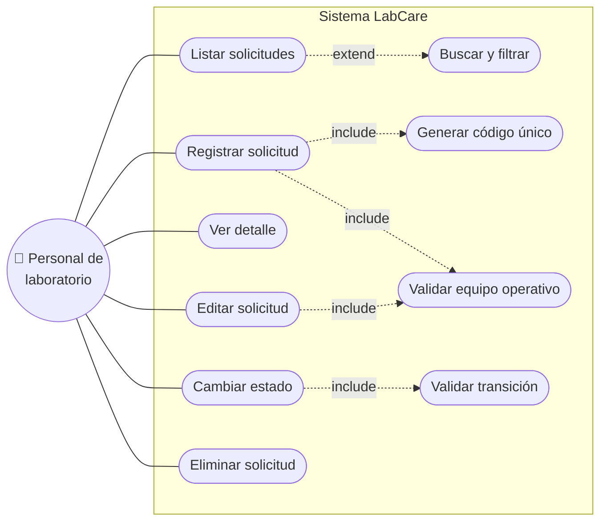
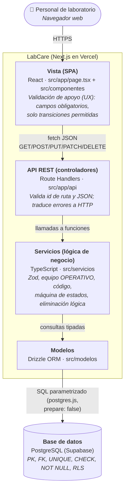

# ANÁLISIS — LabCare: módulo de solicitudes de mantenimiento

## 1. Actor principal

**Personal de laboratorio**: docentes, auxiliares o encargados que detectan una falla en un equipo (computadora, proyector, router, impresora) y necesitan reportarla y hacer seguimiento hasta su resolución.

## 2. Problema

Las fallas de los equipos se reportan de forma verbal, por mensajes o en papel. No hay un registro único, por lo que:

- se pierden solicitudes o se reportan dos veces;
- no se sabe en qué estado está cada reparación ni desde cuándo;
- no hay trazabilidad (quién reportó, qué equipo, con qué prioridad);
- es difícil priorizar el trabajo del personal técnico.

## 3. Alcance

**Incluye**: registro de solicitudes de mantenimiento sobre equipos existentes, código automático, consulta con búsqueda y filtros, detalle, edición de datos, control del ciclo de vida mediante estados con transiciones válidas y eliminación lógica. API REST y una pantalla web principal.

**No incluye** (fuera del examen): autenticación y roles, CRUD de equipos (se cargan por semilla), asignación de técnicos, adjuntos, notificaciones, reportes e historial de cambios de estado.

## 4. Requisitos funcionales

| ID | Requisito |
|---|---|
| RF-01 | Registrar una solicitud indicando equipo, solicitante, descripción y prioridad. |
| RF-02 | Generar automáticamente un código único `SOL-AAAAMMDD-XXX` (correlativo del día; reintenta si hay colisión). |
| RF-03 | Asignar siempre el estado inicial `PENDIENTE`, aunque el cliente envíe otro. |
| RF-04 | Listar las solicitudes activas con los datos del equipo, ordenadas por fecha de registro descendente. |
| RF-05 | Buscar sin distinguir mayúsculas por código, solicitante o nombre del equipo. |
| RF-06 | Filtrar el listado por prioridad y por estado. |
| RF-07 | Consultar el detalle de una solicitud. |
| RF-08 | Editar equipo, solicitante, descripción y prioridad de una solicitud no finalizada (nunca id, código, estado, fecha de registro ni activo). |
| RF-09 | Cambiar el estado respetando las transiciones permitidas. |
| RF-10 | Eliminar lógicamente una solicitud (activo = false), con confirmación. |

## 5. Reglas de negocio

| ID | Regla | Dónde se valida |
|---|---|---|
| RN-01 | El equipo debe existir y estar `OPERATIVO`; si no, 400 y no se crea nada. | `src/servicios/solicitudes.ts` (`exigirEquipoOperativo`, con `SELECT … FOR SHARE`) + FK en BD |
| RN-02 | Solicitante obligatorio, ≥ 3 caracteres tras `trim`. | `src/servicios/validaciones.ts` (Zod) + `CHECK` en BD |
| RN-03 | Descripción obligatoria, ≥ 10 caracteres tras `trim`. | `src/servicios/validaciones.ts` (Zod) + `CHECK` en BD |
| RN-04 | Prioridad ∈ {BAJA, MEDIA, ALTA}. | Zod + `CHECK` en BD |
| RN-05 | Estado inicial siempre `PENDIENTE`. | `crearSolicitud` (el esquema Zod descarta `estado`) |
| RN-06 | Código `SOL-AAAAMMDD-XXX` único; fecha en zona America/La_Paz; reintento ante colisión. | `src/servicios/codigo.ts` + `UNIQUE` en BD |
| RN-07 | Transiciones: PENDIENTE → EN_PROCESO \| CANCELADA; EN_PROCESO → RESUELTA \| CANCELADA; RESUELTA y CANCELADA finales. Inválida → 409 sin cambios. | `src/servicios/transiciones.ts` (con `SELECT … FOR UPDATE`) |
| RN-08 | La edición solo cambia campos permitidos y actualiza `fecha_actualizacion`. | `actualizarSolicitud` (lista blanca explícita) |
| RN-09 | Eliminación lógica; una solicitud inactiva responde 404 y no aparece en el listado. | `eliminarSolicitud` / filtros `activo = true` |
| RN-10 | Respuestas: 200/201, 400 con mensajes por campo, 404, 409, 500 genérico sin detalles. | `src/app/api/_lib/http.ts` (`manejarError`) |
| RN-11 | Una solicitud RESUELTA o CANCELADA no se puede editar: 409 "No se puede editar una solicitud resuelta o cancelada". La interfaz deshabilita "Editar". | `validarEditable` en `src/servicios/transiciones.ts`, usada en `actualizarSolicitud` (con `FOR UPDATE`) |

La interfaz también limita opciones (por ejemplo, solo ofrece las transiciones permitidas), pero **toda regla se valida en el backend**: la vista es solo una ayuda.

## 6. Diagrama de casos de uso

## 7. Diagrama C4: contenedores

**Dónde se valida (defensa en profundidad):**

1. **Vista**: solo ayuda al usuario (no confiable).
2. **API**: formato del id y del JSON.
3. **Servicios**: todas las reglas de negocio (fuente de verdad).
4. **Base de datos**: restricciones como última barrera (CHECK, UNIQUE, FK, NOT NULL).

## 8. Endpoints

| Método | Ruta | Descripción | Respuestas |
|---|---|---|---|
| GET | `/api/equipos` | Lista de equipos | 200 |
| GET | `/api/solicitudes?q=&prioridad=&estado=` | Listado activo con búsqueda y filtros | 200, 400 |
| POST | `/api/solicitudes` | Registrar | 201, 400 |
| GET | `/api/solicitudes/{id}` | Detalle | 200, 404 |
| PUT | `/api/solicitudes/{id}` | Editar (no en estado final) | 200, 400, 404, 409 |
| DELETE | `/api/solicitudes/{id}` | Eliminación lógica | 200, 404 |
| PATCH | `/api/solicitudes/{id}/estado` | Cambiar estado | 200, 400, 404, 409 |
